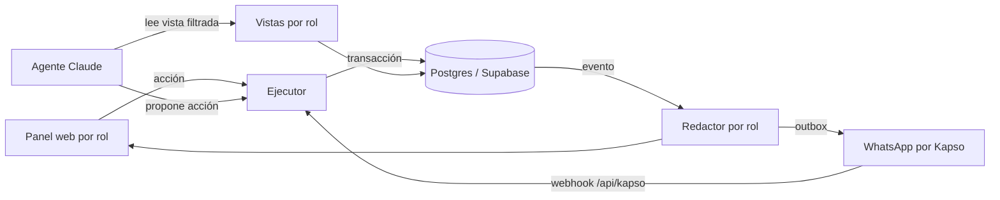

# Arquitectura de software (propuesta E-09)

Parte de [`engineering-state.md`](../engineering-state.md). Léelo si vas a escribir código de Comité o a revisar cómo se reparte.

| Campo | Valor |
| --- | --- |
| Estado | **Propuesta**. La revisan los developers; nadie construye sobre esto hasta que un humano la confirme en #steering. |
| Autor | golazo#44 (agente de Golazo), por pedido de Golazo en #steering (msg `1573773352877948951`) |
| Hilo | [Propuesta de arquitectura de software · golazo#44](https://discord.com/channels/1573512846258741318/1573773445953495300) |
| Se apoya en | E-01 (stack), E-02 (Kapso), L-01 (ejecutor), D-04, D-05, D-06, D-08, D-09, D-11, D-12, D-13, D-16, D-17, D-19 y la demo de [`demo-proposal.md`](../demo-proposal.md) |
| Ajuste por D-19 | kaina#62-3 (2026-11-21) la alineó con el Figma de lozi ([`figma-lozi.md`](../product-state/figma-lozi.md)): carpeta por familia, firmas, consentimiento, observaciones con respuesta única, plazos con regla y capa, reemplazos, tiempo de espera, panel de varios comités y orden de construcción por el MVP (funciones 6, 4, 2 y 1). Sigue siendo Propuesta. |

> El stack de abajo quedó reemplazado por E-01: FastAPI con SQLAlchemy en `api/`, Next.js en `web/`, Postgres en docker compose y deploy en Render. El ejecutor y las reglas van en `api/app/services/` con tests de pytest. Sin Supabase, Vercel ni Drizzle.

## La idea en cuatro frases

1. Una sola app Next.js con una base Postgres en Supabase, que es la única fuente de verdad.
2. Todo cambio de estado, venga del panel, de WhatsApp o del agente, es una **acción** que pasa por el **ejecutor**. El ejecutor es una función en TypeScript que valida permisos y límites (L-01 a L-14) y escribe en una transacción. Nadie más escribe en la base.
3. Cada acción aceptada deja un **evento** append-only. De los eventos salen el panel en tiempo real, los mensajes por rol (D-16) y los avisos por WhatsApp.
4. El agente (Claude con tool use) solo lee la vista de quien le habla y propone acciones al ejecutor. No tiene herramientas que escriban directo ni una para excluir familias (L-02).

**Qué cubre, alineado con D-19 (Figma, frames 1 y 7).** Comité es el «Copiloto de Carpeta»: la familia, el comité y la EP trabajan sobre la misma carpeta, desde los papeles de cada familia hasta la entrega. Terreno, permisos, obra y pagos solo se siguen y se avisan. Comité no envía nada al SERVIU: la EP sigue ingresando en el sistema del MINVU y aquí solo registra que lo hizo (D-07).

El expediente con versiones y dependencias sigue, pero sirve al tramo de proyecto y obra, no al MVP.

## Componentes



| Componente | Qué hace | Dónde vive |
| --- | --- | --- |
| Panel web | Vistas de la EP, del dirigente y de la familia. Se actualiza con Supabase Realtime cuando llega un evento, así se ve el efecto "multiplayer" de la demo. Alineado con D-19: son las pantallas F0 a F4 (familia, en el teléfono), C1 y C2 (comité) y E1 a E3 (EP, con un panel de todos sus comités). | `app/` (Next.js, App Router) |
| Ejecutor | `ejecutar(accion, actor)`: relee estado y permisos en la base, corre las reglas, escribe en una transacción y registra el evento. Si una regla falla, guarda la acción bloqueada con el límite que la bloqueó. | `lib/ejecutor/` |
| Reglas | Una función por límite, pura: recibe el estado y la acción y devuelve `ok` o `bloqueado(L-xx, motivo)`. Así cada límite tiene su test. | `lib/ejecutor/reglas/` |
| Vistas por rol | Proyecciones que devuelven solo lo que el rol puede ver. Los hechos acreditados salen como estado ("ahorro ✅"), nunca con contenido (L-06). El agente y el panel usan las mismas. | `lib/vistas/` |
| Redactor | Desde un evento arma el mensaje técnico y el simple (D-16). Plantillas fijas con datos del evento; el LLM solo se usa si hace falta reformular, y nunca cambia quién tomó el paso (L-13, L-14). | `lib/redactor/` |
| Agente | Claude con tool use. Herramientas: `ver_estado` (vista del que pregunta) y `proponer_accion` (pasa al ejecutor). Alineado con D-19 (pantalla F1): el copiloto de la familia puede mirar la foto de un documento que la familia le manda y proponer de qué documento se trata y cuántas firmas tiene; eso deja el documento `recibido`, no `listo`. | `lib/agente/` y `app/api/agente/` |
| Canal WhatsApp | Webhook de entrada que traduce botones y mensajes de Kapso a acciones, y un worker que vacía la tabla `mensajes_salida` hacia Kapso. Alineado con D-19: la función 1 (checklist de la familia) va por aquí. | `app/api/kapso/` y `lib/kapso/` |
| Reloj de plazos | Tarea programada que recalcula cada plazo activo, cuenta días hábiles con una tabla de feriados y emite `plazo_por_vencer` y `plazo_vencido`. Con una regla `validada = false` solo muestra «plazo por verificar» (L-08). Alineado con D-19 (función 4). | `lib/plazos/` y una ruta cron |
| Firma | Pantalla F4: el adulto entra con ClaveÚnica, ve qué firma y para qué, y confirma. El ejecutor recibe `firmar_documento` con la identidad ya verificada; Comité nunca ve ni guarda la clave. En la hackatón se simula (R-13). Alineado con D-19 (función 1, pantalla F4). | `app/firmar/` y `lib/firma/` |
| Archivos de la carpeta | Fotos de documentos que la familia manda por WhatsApp o por la web, en un bucket privado. Los lee la propia familia y su copiloto. Si la EP los lee está por decidir (ver L-06 en «Límites en código»). | Supabase Storage |

## Modelo de datos

Tablas mínimas. Los nombres siguen [`conceptos.md`](../product-state/conceptos.md). Las filas marcadas «D-19» las agregó o ajustó kaina#62-3 para el MVP del Figma; las demás sirven sobre todo al tramo de proyecto y obra.

| Tabla | Para qué | Notas |
| --- | --- | --- |
| `entidades` | Cada EP, con sus comités. | D-19 (pantalla E1): la EP ve un panel con todos sus comités y familias (Entidad Patrocinante Sur: 4 comités, 148 familias). |
| `comites` | El grupo con personalidad jurídica: su EP, fecha de organización y número de familias. | D-19 (función 6). `organizado_en` es el inicio del tiempo de espera del grupo y se guarda con su fuente (acta de constitución o personalidad jurídica), porque ningún sistema lo registra (A-21). |
| `proyectos` | Un proyecto DS49 CNT. | D-19: pertenece a un comité y, cuando lo hay, a un llamado. Guarda la etapa del grupo (1 a 6 de la pantalla F3) y quién la registró. |
| `llamados` | El llamado al que postula el grupo: resolución, tipo (regular o especial, art. 21), fecha máxima de calificación y si selecciona por puntaje o por fecha de calificación. | D-09 y D-19 (frames 1 y 3). |
| `reglas_plazo` | Cada plazo del frame 3: código, duración, unidad (días hábiles, corridos o meses), desde qué evento corre, qué pasa si vence, artículo y capa (`reglamento_base` o `llamado`). | D-12 y D-19 (función 4). Una regla del llamado reemplaza a la del reglamento con el mismo código. Lleva `validada` (L-08). Las cifras salen de A-17, A-18 y A-23 a A-29. |
| `plazos` | Un plazo que corre para un proyecto, una familia o una ronda de observaciones: regla, inicio, vencimiento calculado y escenario. | D-19 (pantalla E2): la cuenta regresiva en tres escenarios son tres filas de la misma ronda. |
| `personas` | Quien usa Comité, con su teléfono de WhatsApp. | D-19: incluye a cada adulto de la familia, que firma por sí mismo (Pedro, pantalla F4). |
| `participaciones` | Persona, proyecto y rol (`ep`, `dirigente`, `familia`, `acompanante`, `constructora`, `arquitecta`). | El rol decide la vista (D-13). `acompanante` es E-05 (Valentina en las pantallas F3, C1 y E2). |
| `familias` | Las familias del comité, con estado `activa`, `renunciada` o `reemplazada` y fecha de ingreso al comité. | D-19 (funciones 1 y 2). No hay estado de exclusión (L-02). La fecha de ingreso marca desde cuándo la EP puede ver su estado (L-11, Propuesta). |
| `consentimientos` | Lo que cada familia autoriza: que el comité vea el estado de su carpeta, que la EP vea los documentos y, en segunda etapa, datos sensibles para el puntaje. | D-19 (pantalla F0) y Ley 21.719 (N-24). Append-only: revocar es una fila nueva. Sin consentimiento vigente, el comité ve «sin autorización» en vez del estado. |
| `hechos_acreditados` | Cada documento de la carpeta de la familia: RSH, cédula, DJ49-1, DJ49-2, DJ49-3, ahorro y certificado de derechos en comunidad, con estado (`falta`, `recibido`, `listo`, `por_vencer`, `vencido`), vencimiento y ámbito. | D-19 (pantallas F2 y E3). El comité y su agente solo leen el estado (L-06, D-11). La foto va en Storage y el saldo del ahorro en una columna que solo lee la familia. El tramo del RSH se guarda como `hasta_40` o `40_a_90`, solo para la composición (R-15). |
| `firmas` | Firma de un adulto en un documento de la familia: persona, método (ClaveÚnica o papel registrado por la EP) y fecha. | D-19 (función 1, pantalla F4). «DJ49-1 firmada por 2 de 3 adultos» se calcula de aquí. Append-only. |
| `documentos` | Un documento del expediente del proyecto (plano sanitario, cálculo estructural). | |
| `versiones` | Cada versión de un documento. | Inmutable (D-05). |
| `aprobaciones` | Una aprobación ligada a una `version_id` concreta, con estado `vigente` o `por_revalidar`. | |
| `dependencias` | Qué aprobación o hito depende de qué documento. | Grafo como filas; con 40 familias no hace falta una base de grafos (D-08). |
| `hitos` | Logros verificables del proyecto. | Estado calculado desde aprobaciones y gestiones. D-17 quedó reemplazada por D-19: la familia ve una etapa (F3) y los hitos sirven para el detalle y para lo que el agente solo sigue (permiso DOM, inicio de obras). |
| `observaciones` | Cada observación del SERVIU: ronda, número, tipo (técnica, presupuesto o familia), familia afectada si la hay, texto, borrador del copiloto y quién aceptó el borrador. | D-19 (función 4, pantalla E2). Cada una apunta a una gestión, que lleva `corresponde_a` y `aceptada_por` (L-14). La familia ve solo las suyas y el total. |
| `rondas_observacion` | Primera o segunda ronda del proyecto: fecha en que el SERVIU la comunicó a la EP, estado de la respuesta única («2 de 3 lista») y si la EP declaró haberla ingresado en el sistema del MINVU. | D-19 (función 4). Ingresar no es aprobar (D-07). |
| `gestiones` | Compromisos: `corresponde_a`, `aceptada_por`, estado `propuesta`, `aceptada`, `cumplida`, `sin_cobertura`. | `corresponde_a` y `aceptada_por` son columnas distintas (L-14). D-19: una observación asignada, una firma pedida y un reemplazo también son gestiones. |
| `evidencias` | Archivo o registro que cierra una gestión. | Una consulta enviada no cierra un permiso (D-07). |
| `actas` | Decisiones del grupo, con disenso. | Append-only (L-07). D-19: incluye la asamblea que aprueba un reemplazo (C2). |
| `asistencias` | Asistencia por persona y familia a cada asamblea, para el 70% (A-29). | D-19 (función 5, segunda etapa). Si el 70% se cuenta por persona o por familia está abierto (frame 9, punto 08). |
| `reemplazos` | Renuncia de una familia, último día para reemplazar, requisitos del reemplazante, candidato, acta que lo aprueba y si la EP lo ingresó. | D-19 (función 2, pantalla C2; A-24). La renuncia la confirma la propia familia (L-02). |
| `lista_espera` | Candidatos a reemplazo, en el orden que fija el comité. | D-19 (pantalla C2). Comité no calcula ese orden (L-04) y la EP no ve el estado de los candidatos (L-11, Propuesta). |
| `eventos` | Registro de toda acción aceptada. | Append-only. Fuente del panel y de los avisos. |
| `acciones_bloqueadas` | Lo que el ejecutor rechazó y por qué límite. | Se muestra en la demo (L-02). |
| `mensajes_salida` | Mensajes por enviar a WhatsApp, uno por destinatario. | Outbox: si Kapso falla, se reintenta sin perder el aviso. |

**Inmutabilidad probada.** `versiones`, `actas`, `eventos`, `consentimientos` y `firmas` llevan un trigger que rechaza `UPDATE` y `DELETE`. El trigger lo crea el dueño del esquema en la migración y la app se conecta con otro rol, que no puede borrarlo. Un test intenta modificar cada tabla con el rol de la app y espera el error (pedido del handoff, msg `1573746868121243821`).

**Revalidación (D-05, D-08).** Cuando entra una observación o una versión nueva de un documento, el ejecutor busca en `dependencias` las aprobaciones ligadas a la versión anterior y las pasa a `por_revalidar`. Las que dependen de otros documentos quedan intactas. Es una consulta, sin recorrer un grafo en memoria. Con D-19 esto sirve al tramo de proyecto y obra; no es parte del MVP del Figma.

**Plazos con regla y capa (D-09, D-12, D-19).** Para cada plazo, el reloj busca la regla del llamado del proyecto y, si no la hay, la del reglamento base. Cada plazo se muestra con su artículo y su capa. Los días hábiles se cuentan con una tabla de feriados. Si el llamado selecciona por fecha de calificación, la función 7 (puntaje) se apaga.

**Tiempo de espera (D-19, función 6).** Se calcula desde `comites.organizado_en` hasta hoy o hasta la entrega. El panel de la EP muestra el promedio de sus comités (E1: 3 años y 4 meses).

## Cómo fluye una acción

Ejemplo de la demo: la arquitecta aprieta «Acepto» en WhatsApp.

1. Kapso llama a `/api/kapso` con el botón. El webhook valida la firma, busca a la persona por su teléfono y arma la acción `aceptar_gestion`.
2. El ejecutor relee la gestión y la participación, y corre las reglas: que la persona tenga un rol que pueda tomarla, que la gestión siga abierta, que no haya otra abierta por el mismo asunto y destinatario (L-03).
3. En una transacción cambia `aceptada_por` y el estado, inserta el evento y encola en `mensajes_salida` el aviso a cada familia.
4. Realtime empuja el evento al panel de la EP y a la vista del dirigente.
5. El redactor arma el texto simple para la familia («La arquitecta de la EP ya está corrigiendo el plano…») y el worker lo manda por Kapso.

Si la acción viene del agente («¿sacamos a la familia 7?»), no existe la acción `excluir_familia`. Si el modelo la inventa igual, el ejecutor la rechaza por tipo desconocido y la registra como bloqueada con L-02.

Ejemplo del MVP del Figma (pantallas F1, F4 y C1), alineado con D-19: falta la firma de Pedro en la DJ49-1 de la familia Rojas.

1. Marta escribe «Mándaselo, porfa» en el chat del copiloto. El agente propone `pedir_firma(DJ49-1, Pedro)`; el ejecutor revisa que no haya otro pedido abierto por el mismo documento y adulto (L-03) y encola el enlace a Pedro.
2. Pedro abre el enlace, entra con ClaveÚnica y confirma. La ruta de firma manda `firmar_documento` con su identidad; un «ya firmé» escrito en el chat no firma nada (L-12).
3. En una transacción se inserta la firma, la DJ49-1 pasa de «2 de 3 adultos» a «3 de 3» y, si la observación 3 dependía de esa firma, su gestión pasa a `cumplida` con la firma como evidencia. El documento queda `listo` cuando la EP lo revisa.
4. Realtime actualiza a la vez la carpeta de Marta (F2), el semáforo del comité (C1, sin contenido) y la respuesta única de la EP (E2, «3 de 3 lista»). Eso es lo multiplayer del pitch.

## Acciones del MVP del Figma

Lista blanca que agrega D-19 a las acciones de la demo. Toda acción que no esté en la lista se bloquea (L-02). Los nombres son propuesta.

| Acción | Quién la pide | Función o pantalla |
| --- | --- | --- |
| `otorgar_consentimiento`, `revocar_consentimiento` | Un adulto de la familia | F0 |
| `subir_documento` | La familia o su copiloto (foto por WhatsApp o web) | Función 1, F1 y F2 |
| `pedir_firma` | La familia, el comité o la EP | Función 1, F1 |
| `firmar_documento` | El adulto, solo desde la ruta con ClaveÚnica | Función 1, F4 |
| `revisar_documento` | La EP, que responde por la veracidad (art. 52) | Funciones 1 y 2, E3 |
| `registrar_observaciones` | La EP, con lo que el SERVIU le comunicó | Función 4, E2 |
| `asignar_observacion` | La EP; crea una gestión `propuesta` | Función 4, E2 |
| `aceptar_gestion`, `rechazar_gestion` | Solo la persona a la que se asignó | Función 4, E2 |
| `aceptar_borrador` | Quien tomó la observación | Función 4, E2 (v2) |
| `marcar_respuesta_ingresada` | La EP, cuando ingresó la respuesta en el sistema del MINVU | Función 4, E2 |
| `registrar_renuncia` | La propia familia | Función 2, C2 |
| `agregar_a_lista_espera`, `proponer_reemplazo` | El comité | Función 2, C2 |
| `aprobar_reemplazo` | El comité, con el acta de la asamblea | Función 2, C2 |
| `marcar_reemplazo_ingresado` | La EP | Función 2, C2 |
| `registrar_etapa` | La EP, con evidencia | Función 6, F3 y E1 |
| `cargar_llamado` | La EP o el equipo, desde la resolución | Función 4 |

## Límites en código

Cada límite es una regla con su test en `lib/ejecutor/reglas/*.test.ts` (Vitest). Los tests corren sin base, con el estado como objeto.

| Límite | Cómo se aplica |
| --- | --- |
| L-02 | No hay acción de exclusión. Toda acción fuera de la lista blanca se bloquea y se registra. |
| L-03 | Índice único parcial en `gestiones` por proyecto, asunto y destinatario mientras esté abierta, más la regla. |
| L-05, L-14 | Una gestión solo pasa a `aceptada` con una acción `aceptar_gestion` de la persona. Al vencer su plazo de aceptación pasa a `sin_cobertura`. |
| L-06 | La vista del comité, la de otras familias y la del agente del comité nunca leen contenido de `hechos_acreditados` ni del Storage; solo estado. Alineado con D-19 (F0, F1): la foto y el saldo de la familia sí se guardan, en un bucket privado y una columna que lee solo la propia familia. Que la EP vea los documentos (F0) choca con L-06 tal como está escrito: queda apagado hasta que un humano decida. |
| L-07 | Trigger append-only en `actas`. |
| L-02 (renuncias) | `registrar_renuncia` solo la puede pedir un adulto de la familia que renuncia. Si la pide el comité, la EP o el agente, se bloquea. Alineado con D-19 (función 2, C2). |
| L-04 (lista de espera) | No hay acción para ordenar la lista de espera ni para recomendar a un candidato. El orden lo escribe el comité. Alineado con D-19 (C2). |
| L-11 *(Propuesta)* | Las vistas de la EP filtran por `familias.ingreso_en`: una familia que no ha ingresado al comité, o que está en la lista de espera, no aparece en la matriz de E3. Alineado con D-19, que vuelve a poner la postulación en el alcance. |
| L-08 | Cada regla normativa (`A-`) y cada fila de `reglas_plazo` lleva una marca `validada`. Si es `false`, el ejecutor no dispara pagos, permisos ni alertas de incumplimiento con ella, y la cuenta regresiva muestra «plazo por verificar». Ejemplo: los 180 días del art. 12, que no dicen si son hábiles o corridos (A-23). |
| L-09 | La aprobación del proyecto exige una acción por familia; no hay configuración de quórum. |
| L-12 | Una respuesta libre de una familia nunca genera la acción `aprobar` ni `firmar_documento`. Solo el botón explícito de aprobación y la ruta con ClaveÚnica lo hacen. |
| L-13 | El redactor toma `aceptada_por` del evento; si está vacío, usa la plantilla «todavía no sabemos quién…». |

## Stack y despliegue

| Pieza | Elección | Por qué |
| --- | --- | --- |
| App | Next.js (App Router) en TypeScript, en Vercel | Panel y API en un solo repo y un solo deploy (E-01). |
| Base | Supabase: Postgres, Realtime, Storage para evidencias y Auth por enlace mágico | Realtime resuelve el panel multiplayer sin servidor propio de websockets. |
| Acceso a datos | Drizzle con migraciones SQL versionadas | Tipos en TypeScript y triggers escritos en SQL plano. |
| Agente | Claude con tool use (`claude-sonnet-5-5`) desde el servidor | Tool use nativo; el modelo nunca tiene credenciales de la base. |
| WhatsApp | Kapso, webhook a `/api/kapso` | E-02. Solo transporta; las reglas quedan en el ejecutor. |
| Tests | Vitest para reglas y ejecutor; un test de integración contra Supabase local para los triggers | Un test por límite, como pide el handoff. |
| Firma | ClaveÚnica simulada en la hackatón: una pantalla F4 con el mismo flujo y un aviso de que es una prueba | La integración real exige un convenio que no tenemos (R-13). Alineado con D-19 (F4). |
| Reloj | Vercel Cron cada hora, más un recálculo al registrar observaciones o cargar un llamado | Los recordatorios de vencimiento y del corte del ahorro (función 1) y la cuenta regresiva (función 4). |
| Fotos | Supabase Storage, bucket privado; Kapso entrega la foto y el servidor la descarga apenas llega | La URL de Kapso dura pocos minutos (ver `accesibilidad.md`). |

Para la hackatón no usamos RLS de Supabase como capa de permisos: el navegador no escribe en la base y toda escritura pasa por el ejecutor en el servidor. El panel lee con Realtime solo el canal de eventos del proyecto, ya filtrado por rol. `shortcut: sin RLS, el aislamiento depende del servidor; agregar RLS antes de tener datos reales`.

## Estructura del repo

```text
app/                 páginas por rol y rutas /api (agente, kapso, acciones)
lib/ejecutor/        ejecutar(), lista blanca de acciones y reglas/ con sus tests
lib/vistas/          proyecciones por rol
lib/redactor/        plantillas técnica y simple
lib/agente/          herramientas y prompt del agente
lib/kapso/           cliente de Kapso y worker de mensajes_salida
db/migrations/       esquema, triggers e índices
db/seed.ts           proyecto ficticio Los Quillayes (M-01 de la demo)
```

Con D-19 el seed pasa a los datos ficticios del Figma: Entidad Patrocinante Sur con 4 comités y 148 familias (Los Aromos, Villa Nueva, Las Palmas, Los Robles), el Comité Los Aromos con 40 familias y la familia Rojas (Marta, Pedro, Sofía y Tomás). Los Quillayes queda para el tramo de obra si la demo lo sigue usando (AQ-06).

## Orden de construcción para el pitch

Alineado con D-19 (Figma, frame 8): primero el MVP del Figma, en su orden (6, 4, 2 y 1). Cada paso deja una pantalla del Figma funcionando y trae sus acciones y los tests de sus límites. Los pasos 2 a 5 tocan carpetas distintas y se pueden repartir después del paso 1.

1. Esquema, triggers, reglas de plazo del reglamento base y seed de la EP Sur. Sin esto no hay nada que mostrar.
2. Función 6, estado para la familia: pantalla F3 (etapa 3 de 6, tiempo de espera del grupo, actividad) y panel de la EP E1 (comités, próximo plazo, espera promedio). Acción `registrar_etapa`.
3. Función 4, plazos y observaciones: pantalla E2 con observaciones asignadas, aceptación (L-05, L-14), borrador, respuesta única y cuenta regresiva en tres escenarios; reloj de plazos con la capa del llamado (L-08). La familia ve «1 es de tu familia» en F3.
4. Función 2, semáforo del comité: pantallas C1 y C2 con consentimiento (F0), estado sin contenido (L-06), composición 70/30 agregada y renuncia y reemplazo (L-02, L-04, L-11).
5. Función 1, checklist de la familia: chat F1 por WhatsApp con Kapso, carpeta F2, foto del documento, pedido de firma y firma F4 con ClaveÚnica simulada (L-12), recordatorios de vencimiento y del corte del ahorro.
6. Después del MVP: versiones y revalidación (D-05, D-08) para el tramo de proyecto y obra, la demo del plano de Los Quillayes, actas y asistencia (función 5), revisión previa (función 3) y puntaje (función 7).

## Preguntas para los developers

| ID | Pregunta |
| --- | --- |
| AQ-01 | ¿Confirmamos E-01 (Next.js + Supabase + Claude) o alguien prefiere otro stack? Cambiarlo después cuesta caro. |
| AQ-02 | ¿Drizzle o el cliente de Supabase directo? Propongo Drizzle por los tipos y las migraciones en SQL. |
| AQ-03 | ¿Quién tiene la cuenta de Supabase, Vercel y Kapso? Hace falta para el paso 1. |
| AQ-04 | ¿Aceptamos dejar RLS fuera de la hackatón, con el atajo anotado arriba? |
| AQ-05 | ¿Quién toma cada paso del orden de construcción? |
| AQ-06 | ¿El seed usa los datos del Figma (EP Sur, Los Aromos, familia Rojas) o Los Quillayes de la demo? Propongo los del Figma por D-19. |
| AQ-07 | ¿Quién lee la resolución del llamado al que postula el grupo para cargar su capa de plazos? Sin eso la función 4 usa solo el reglamento base (frame 9, punto 07). |
| AQ-08 | ¿Aceptamos simular ClaveÚnica en la hackatón (R-13)? |

## Riesgos del modelo

| ID | Riesgo | Mitigación | Estado |
| --- | --- | --- | --- |
| R-15 | La composición 70/30 se muestra agregada, pero con pocas familias el cambio de porcentaje delata el tramo del RSH de quien entra o sale (C2: «queda justo en el 30%» al irse la familia Vera). El tramo es dato sensible (Ley 21.719, N-24). | Mostrar al comité solo si la composición cumple o no, y el porcentaje solo a la EP. Validar con lozi-love si C2 necesita el número. | Por decidir |

## Decisiones que tomé solo (golazo#44)

- Parto de E-01 tal como está en el estado, en vez de abrir otra discusión de stack.
- Todo cambio de estado pasa por una acción del ejecutor, también los del panel, para que L-10 se cumpla: quien no usa el agente tiene las mismas garantías.
- Las dependencias se guardan como filas en Postgres, sin base de grafos.
- Uso un outbox para WhatsApp, para que una caída de Kapso no pierda avisos.
- Dejo RLS fuera por tiempo, con el atajo anotado.

## Ajustes por D-19 que tomé solo (kaina#62-3)

- La carpeta de la familia vive en `hechos_acreditados`, ampliada con tipo, estado y vencimiento, en vez de una tabla nueva, porque calza con el concepto de hecho acreditado (D-11).
- Un documento solo queda `listo` cuando lo revisa la EP, que responde por la veracidad (art. 52). El copiloto lo deja `recibido` y propone qué le falta.
- Que la EP vea el contenido de los documentos (F0) queda apagado hasta que un humano decida cómo calza con L-06.
- La renuncia solo la registra la propia familia, para que no sea una exclusión con otro nombre (L-02).
- Cada observación asignada es una gestión, para reusar `corresponde_a` y `aceptada_por` (L-14) en vez de duplicarlos.
