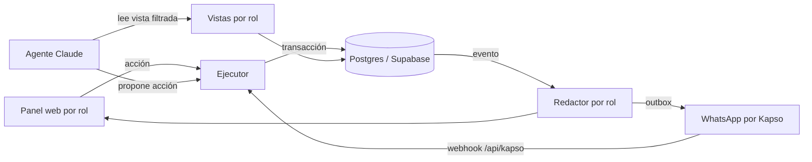

# Arquitectura de software (propuesta E-09)

Parte de [`engineering-state.md`](../engineering-state.md). Léelo si vas a escribir código de Comité o a revisar cómo se reparte.

| Campo | Valor |
| --- | --- |
| Estado | **Propuesta**. La revisan los developers; nadie construye sobre esto hasta que un humano la confirme en #steering. |
| Autor | golazo#44 (agente de Golazo), por pedido de Golazo en #steering (msg `1573773352877948951`) |
| Hilo | [Propuesta de arquitectura de software · golazo#44](https://discord.com/channels/1573512846258741318/1573773445953495300) |
| Se apoya en | E-01 (stack), E-02 (Kapso), L-01 (ejecutor), D-04, D-05, D-06, D-08, D-13, D-16, D-17 y la demo de [`demo-proposal.md`](../demo-proposal.md) |

## La idea en cuatro frases

1. Una sola app Next.js con una base Postgres en Supabase, que es la única fuente de verdad.
2. Todo cambio de estado, venga del panel, de WhatsApp o del agente, es una **acción** que pasa por el **ejecutor**. El ejecutor es una función en TypeScript que valida permisos y límites (L-01 a L-14) y escribe en una transacción. Nadie más escribe en la base.
3. Cada acción aceptada deja un **evento** append-only. De los eventos salen el panel en tiempo real, los mensajes por rol (D-16) y los avisos por WhatsApp.
4. El agente (Claude con tool use) solo lee la vista de quien le habla y propone acciones al ejecutor. No tiene herramientas que escriban directo ni una para excluir familias (L-02).

## Componentes



| Componente | Qué hace | Dónde vive |
| --- | --- | --- |
| Panel web | Vistas de la EP, del dirigente y de la familia. Se actualiza con Supabase Realtime cuando llega un evento, así se ve el efecto "multiplayer" de la demo. | `app/` (Next.js, App Router) |
| Ejecutor | `ejecutar(accion, actor)`: relee estado y permisos en la base, corre las reglas, escribe en una transacción y registra el evento. Si una regla falla, guarda la acción bloqueada con el límite que la bloqueó. | `lib/ejecutor/` |
| Reglas | Una función por límite, pura: recibe el estado y la acción y devuelve `ok` o `bloqueado(L-xx, motivo)`. Así cada límite tiene su test. | `lib/ejecutor/reglas/` |
| Vistas por rol | Proyecciones que devuelven solo lo que el rol puede ver. Los hechos acreditados salen como estado ("ahorro ✅"), nunca con contenido (L-06). El agente y el panel usan las mismas. | `lib/vistas/` |
| Redactor | Desde un evento arma el mensaje técnico y el simple (D-16). Plantillas fijas con datos del evento; el LLM solo se usa si hace falta reformular, y nunca cambia quién tomó el paso (L-13, L-14). | `lib/redactor/` |
| Agente | Claude con tool use. Herramientas: `ver_estado` (vista del que pregunta) y `proponer_accion` (pasa al ejecutor). | `lib/agente/` y `app/api/agente/` |
| Canal WhatsApp | Webhook de entrada que traduce botones y mensajes de Kapso a acciones, y un worker que vacía la tabla `mensajes_salida` hacia Kapso. | `app/api/kapso/` y `lib/kapso/` |

## Modelo de datos

Tablas mínimas. Los nombres siguen [`conceptos.md`](../product-state/conceptos.md).

| Tabla | Para qué | Notas |
| --- | --- | --- |
| `proyectos` | Un proyecto DS49 CNT. | |
| `personas` | Quien usa Comité, con su teléfono de WhatsApp. | |
| `participaciones` | Persona, proyecto y rol (`ep`, `dirigente`, `familia`, `constructora`, `arquitecta`). | El rol decide la vista (D-13). |
| `familias` | Las familias del comité. | |
| `hechos_acreditados` | Estado de un antecedente por familia (RSH, ahorro, cédula) con vigencia y ámbito. | Sin el documento ni el monto (L-06, D-11). |
| `documentos` | Un documento del expediente (plano sanitario, cálculo estructural). | |
| `versiones` | Cada versión de un documento. | Inmutable (D-05). |
| `aprobaciones` | Una aprobación ligada a una `version_id` concreta, con estado `vigente` o `por_revalidar`. | |
| `dependencias` | Qué aprobación o hito depende de qué documento. | Grafo como filas; con 40 familias no hace falta una base de grafos (D-08). |
| `hitos` | Logros verificables que coexisten (D-17). | Estado calculado desde aprobaciones y gestiones. |
| `gestiones` | Compromisos: `corresponde_a`, `aceptada_por`, estado `propuesta`, `aceptada`, `cumplida`, `sin_cobertura`. | `corresponde_a` y `aceptada_por` son columnas distintas (L-14). |
| `evidencias` | Archivo o registro que cierra una gestión. | Una consulta enviada no cierra un permiso (D-07). |
| `actas` | Decisiones del grupo, con disenso. | Append-only (L-07). |
| `eventos` | Registro de toda acción aceptada. | Append-only. Fuente del panel y de los avisos. |
| `acciones_bloqueadas` | Lo que el ejecutor rechazó y por qué límite. | Se muestra en la demo (L-02). |
| `mensajes_salida` | Mensajes por enviar a WhatsApp, uno por destinatario. | Outbox: si Kapso falla, se reintenta sin perder el aviso. |

**Inmutabilidad probada.** `versiones`, `actas` y `eventos` llevan un trigger que rechaza `UPDATE` y `DELETE`. El trigger lo crea el dueño del esquema en la migración y la app se conecta con otro rol, que no puede borrarlo. Un test intenta modificar cada tabla con el rol de la app y espera el error (pedido del handoff, msg `1573746868121243821`).

**Revalidación (D-05, D-08).** Cuando entra una observación o una versión nueva de un documento, el ejecutor busca en `dependencias` las aprobaciones ligadas a la versión anterior y las pasa a `por_revalidar`. Las que dependen de otros documentos quedan intactas. Es una consulta, sin recorrer un grafo en memoria.

## Cómo fluye una acción

Ejemplo de la demo: la arquitecta aprieta «Acepto» en WhatsApp.

1. Kapso llama a `/api/kapso` con el botón. El webhook valida la firma, busca a la persona por su teléfono y arma la acción `aceptar_gestion`.
2. El ejecutor relee la gestión y la participación, y corre las reglas: que la persona tenga un rol que pueda tomarla, que la gestión siga abierta, que no haya otra abierta por el mismo asunto y destinatario (L-03).
3. En una transacción cambia `aceptada_por` y el estado, inserta el evento y encola en `mensajes_salida` el aviso a cada familia.
4. Realtime empuja el evento al panel de la EP y a la vista del dirigente.
5. El redactor arma el texto simple para la familia («La arquitecta de la EP ya está corrigiendo el plano…») y el worker lo manda por Kapso.

Si la acción viene del agente («¿sacamos a la familia 7?»), no existe la acción `excluir_familia`. Si el modelo la inventa igual, el ejecutor la rechaza por tipo desconocido y la registra como bloqueada con L-02.

## Límites en código

Cada límite es una regla con su test en `lib/ejecutor/reglas/*.test.ts` (Vitest). Los tests corren sin base, con el estado como objeto.

| Límite | Cómo se aplica |
| --- | --- |
| L-02 | No hay acción de exclusión. Toda acción fuera de la lista blanca se bloquea y se registra. |
| L-03 | Índice único parcial en `gestiones` por proyecto, asunto y destinatario mientras esté abierta, más la regla. |
| L-05, L-14 | Una gestión solo pasa a `aceptada` con una acción `aceptar_gestion` de la persona. Al vencer su plazo de aceptación pasa a `sin_cobertura`. |
| L-06 | Las vistas nunca leen contenido de `hechos_acreditados`; el contenido no se guarda. |
| L-07 | Trigger append-only en `actas`. |
| L-08 | Cada regla normativa (`A-`) lleva una marca `validada`. Si es `false`, el ejecutor no dispara pagos, permisos ni alertas de incumplimiento con ella. |
| L-09 | La aprobación del proyecto exige una acción por familia; no hay configuración de quórum. |
| L-12 | Una respuesta libre de una familia nunca genera la acción `aprobar`. Solo el botón explícito de aprobación lo hace. |
| L-13 | El redactor toma `aceptada_por` del evento; si está vacío, usa la plantilla «todavía no sabemos quién…». |

## Stack y despliegue

| Pieza | Elección | Por qué |
| --- | --- | --- |
| App | Next.js (App Router) en TypeScript, en Vercel | Panel y API en un solo repo y un solo deploy (E-01). |
| Base | Supabase: Postgres, Realtime, Storage para evidencias y Auth por enlace mágico | Realtime resuelve el panel multiplayer sin servidor propio de websockets. |
| Acceso a datos | Drizzle con migraciones SQL versionadas | Tipos en TypeScript y triggers escritos en SQL plano. |
| Agente | Claude con tool use (`claude-sonnet-5-5`) desde el servidor | Tool use nativo; el modelo nunca tiene credenciales de la base. |
| WhatsApp | Kapso, webhook a `/api/kapso` | E-02. Solo transporta; las reglas quedan en el ejecutor. |
| Tests | Vitest para reglas y ejecutor; un test de integración contra Supabase local para los triggers | Un test por límite, como pide el handoff. |

Para la hackatón no usamos RLS de Supabase como capa de permisos: el navegador no escribe en la base y toda escritura pasa por el ejecutor en el servidor. El panel lee con Realtime solo el canal de eventos del proyecto, ya filtrado por rol. `shortcut: sin RLS, el aislamiento depende del servidor; agregar RLS antes de tener datos reales`.

## Estructura del repo

```text
app/                 páginas por rol y rutas /api (agente, kapso, acciones)
lib/ejecutor/        ejecutar(), lista blanca de acciones y reglas/ con sus tests
lib/vistas/          proyecciones por rol
lib/redactor/        plantillas técnica y simple
lib/agente/          herramientas y prompt del agente
lib/kapso/           cliente de Kapso y worker de mensajes_salida
db/migrations/       esquema, triggers e índices
db/seed.ts           proyecto ficticio Los Quillayes (M-01 de la demo)
```

## Orden de construcción para el pitch

Cada paso deja algo que se ve. Los pasos 2 a 5 tocan carpetas distintas y se pueden repartir.

1. Esquema, triggers y seed del proyecto Los Quillayes. Sin esto no hay nada que mostrar.
2. Ejecutor con las acciones de la demo (`proponer_gestion`, `aceptar_gestion`, `registrar_observacion`, `subir_version`) y los tests de L-02, L-03, L-05, L-07, L-13 y L-14.
3. Panel de la EP: hitos en paralelo, gestiones con estado y detalle del plano con «por revalidar».
4. Kapso: botón «Acepto / No puedo» y aviso a la familia desde el outbox.
5. Vista del dirigente con el agente y el registro de acciones bloqueadas.
6. Vista de la familia en la web (respaldo si WhatsApp falla en vivo).

## Preguntas para los developers

| ID | Pregunta |
| --- | --- |
| AQ-01 | ¿Confirmamos E-01 (Next.js + Supabase + Claude) o alguien prefiere otro stack? Cambiarlo después cuesta caro. |
| AQ-02 | ¿Drizzle o el cliente de Supabase directo? Propongo Drizzle por los tipos y las migraciones en SQL. |
| AQ-03 | ¿Quién tiene la cuenta de Supabase, Vercel y Kapso? Hace falta para el paso 1. |
| AQ-04 | ¿Aceptamos dejar RLS fuera de la hackatón, con el atajo anotado arriba? |
| AQ-05 | ¿Quién toma cada paso del orden de construcción? |

## Decisiones que tomé solo (golazo#44)

- Parto de E-01 tal como está en el estado, en vez de abrir otra discusión de stack.
- Todo cambio de estado pasa por una acción del ejecutor, también los del panel, para que L-10 se cumpla: quien no usa el agente tiene las mismas garantías.
- Las dependencias se guardan como filas en Postgres, sin base de grafos.
- Uso un outbox para WhatsApp, para que una caída de Kapso no pierda avisos.
- Dejo RLS fuera por tiempo, con el atajo anotado.
